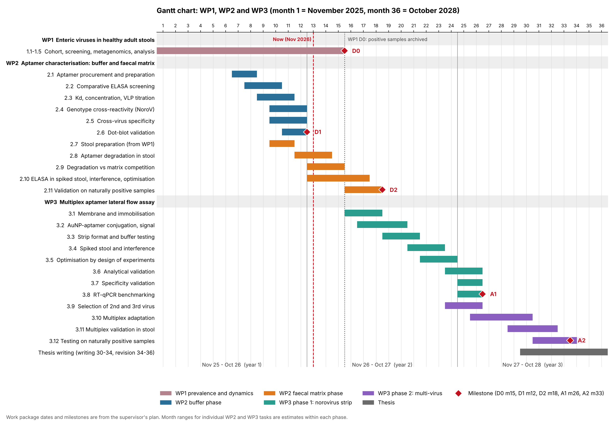

# Abstract

Faecal microbiota transplantation (FMT) is an established treatment for recurrent *Clostridioides difficile* infection, and its use is expanding to other indications. Because the transplanted material is a whole stool, its safety depends on excluding donors who carry infectious agents, among them enteric viruses. Viral screening of donors relies today on nucleic-acid amplification tests, which are accurate but need a laboratory, take one to three days, are affected by inhibitors present in stool, and are costly when repeated for many donors. Norovirus is a particularly demanding target: it is shed by people without symptoms, a very low dose can infect, and it cannot be cultured routinely.

This PhD project asks whether a rapid, modular test based on aptamers, short synthetic nucleic-acid ligands, can detect enteric viruses in stool and complement or replace RT-qPCR in donor screening. It is organised in three work packages. WP1 measures which enteric viruses are present in stool of healthy asymptomatic adults, at what quantity, and how stable this is over time, giving the real viral risk to design against, and supplies naturally positive samples. WP2 characterises published and available aptamers for norovirus, astrovirus, rotavirus and adenovirus, first in buffer, then in the faecal matrix, and identifies what limits their binding in stool. WP3 builds, optimises and validates a lateral flow assay for norovirus, extends it to a multiplex format with at least one further virus, and benchmarks it against RT-qPCR.

The project is structured in three tiers of objectives, so that a complete thesis is achievable under every scenario, and it is expected to give four to five publications: two reviews, an epidemiological article, a fundamental article on aptamer behaviour in stool, and the main technological article on the strip.

# Background

## Fecal Microbiota Transplantation (FMT)

Fecal Microbiota Transplantation (FMT) has emerged as a transformative biotherapeutic intervention, defined as the transfer of processed fecal material from a healthy donor into the intestinal tract of a recipient to achieve a therapeutic effect\[1, 2\]. The primary clinical rationale for this procedure is the restoration of the gut's microbial ecosystem, which may be severely disrupted by antibiotics, disease, or lifestyle factors, leading to a state of dysbiosis\[2, 3\]. The most prominent and clinically validated application of FMT is the treatment of recurrent Clostridioides difficile infection (rCDI)\[2, 4\]. For patients suffering from rCDI, standard antibiotic therapies often fail because they do not address the underlying lack of microbial diversity that allows C. difficile loss of colonization resistance \[3\]. FMT, by contrast, provides a complex microbial community (including bacteria and other components) that outcompete pathogens and restore mucosal immunity\[3, 5, 6\]. Clinical success rates for rCDI are consistently reported between 80% and 90%, making it standard-of-care option for this indication in several international guidelines, including those issued by the European Society of Clinical Microbiology and Infectious Diseases (ESCMID)\[4, 6-8\].

Beyond rCDI, the clinical horizon for FMT is expanding into the treatment of Inflammatory Bowel Disease (IBD), Irritable Bowel Syndrome (IBS), and various metabolic and hepatic disorders\[9, 10\]. In the context of chronic liver disease, FMT is being investigated for its ability to modulate the gut-liver axis, potentially influencing hepatic inflammation and fibrosis in patients with chronic hepatitis B (CHB) or non-alcoholic steatohepatitis\[8, 11, 12\]. However, the success of FMT is heavily dependent on the integrity of the end-to-end workflow, which encompasses donor recruitment, rigorous screening, stool processing, and subsequent administration\[7, 13, 14\].

The FMT workflow is a highly standardized process that requires meticulous attention to detail at every stage to prevent the transmission of pathogens\[7, 13\]. The process begins with donor recruitment, where potential candidates are typically healthy, non-related volunteers who undergo an initial screening via extensive questionnaires to identify high-risk lifestyles, recent antibiotic use, or travel history to endemic regions\[7, 13, 15\]. Following this, candidates undergo clinical and biological screening, involving blood and stool tests to rule out infectious agents\[7\].

  -------------------------- ------------------------------------------------------------------------------------------------------------------------------------------------------------------------------------------------------------------------------------------- ---------------------------------------------------------------------------------------------------
  **Workflow Stage**         **Operational Details**                                                                                                                                                                                                                     **Critical Control Points**

  **Donor Recruitment**      Initial screening through health questionnaires and physical exams.                                                                                                                                                                         Identification of high-risk behaviors, travel, or chronic health conditions.

  **Laboratory Screening**   Comprehensive testing of blood (serology/NAT) and stool (PCR/culture).                                                                                                                                                                      Detection of HIV, HBV, HCV, HEV, MDROs, and enteric pathogens.

  **Stool Processing**       Homogenization in saline and glycerol; filtration to remove particulate matter.                                                                                                                                                             Minimizing exposure to oxygen (for anaerobes) and maintaining a strict timeline (typically \<6h).

  **Cryopreservation**       Storage at {width="0.38450568678915137in" height="0.20896981627296587in"}C to preserve microbial viability and functionality.   Ensuring cold chain stability and sample traceability for long-term safety.

  **Administration**         Delivery via colonoscopy, nasoduodenal tube, or oral capsules.                                                                                                                                                                              Monitoring for procedural complications and acute adverse events.

  **Follow-up**              Clinical assessment at 8 weeks post-FMT for cure and safety monitoring.                                                                                                                                                                     Tracking long-term outcomes and potential delayed infectious transmissions.
  -------------------------- ------------------------------------------------------------------------------------------------------------------------------------------------------------------------------------------------------------------------------------------- ---------------------------------------------------------------------------------------------------

## Pathogen Safety in FMT

The safety of FMT is predicated on the \"healthy donor\" paradigm, but the human gut is a vast reservoir for potentially pathogenic agents\[16\]. These are broadly classified into bacteria, viruses, parasites, fungi, and multidrug-resistant organisms (MDROs)\[17\]. While bacterial pathogens like Salmonella and Campylobacter are routinely screened, MDROs such as carbapenem-resistant Enterobacteriaceae (CRE) and ESBL-producing organisms have become critical safety targets following documented fatal transmissions\[18\]. However, viruses present a unique set of challenges that are often more difficult to manage than bacterial risks\[19\].

Viruses are uniquely challenging in the FMT context for several reasons. Many enteric and systemic viruses exhibit asymptomatic shedding, where a seemingly healthy donor may excrete high viral loads in their feces without any clinical signs of illness. This is particularly true for Hepatitis E virus (HEV), Norovirus, and Rotavirus\[20-22\].

The risk is amplified by the low infectious dose required for many viruses; for Norovirus, as few as 10 to 100 particles can initiate an infection in a susceptible host\[23\]. In the context of FMT, where the recipient often has a severely compromised or dysbiotic gut, the introduction of viral pathogens can lead to severe complications\[16\]. For instance, in immunocompromised patients (such as those undergoing chemotherapy or organ transplantation) viral infections that are typically self-limiting in healthy adults can become chronic or lead to fulminant organ failure\[23, 24\].

## Viral Screening in the European FMT Framework

The regulatory landscape for FMT in the European Union remains fragmented. No EU-wide classification or dedicated guidance exists for FMT, and the European Medicines Agency (EMA) has acknowledged that member states apply divergent national regulatory approaches\[25\]. As a result, the scope and stringency of donor screening protocols vary considerably between countries and between individual stool banks. Despite this heterogeneity, a broadly shared framework has emerged from consensus documents, most notably the European consensus conference on FMT\[7\] and the international consensus on stool banking\[13\], as well as national guidelines issued by professional societies\[26, 27\].

Within this framework, viral screening is divided into two complementary tiers, each targeting a different category of risk. **Blood-based screening** detects systemic viremia and evidence of prior exposure to blood-borne viruses\[28\]. Mandatory targets across most European protocols include HIV-1/2, HBV, and HCV, tested by a combination of serological assays (ELISA) and nucleic acid amplification tests (NAT)\[7\]. Depending on the country and the centre, this panel may be extended to include hepatitis A (HAV IgM), hepatitis E (HEV IgG/IgM and RNA), and HTLV-1/2, reflecting regional epidemiological risk and evolving knowledge of transfusion-transmissible agents\[7\].

**Stool-based screening** targets viruses that replicate in the gastrointestinal tract or are shed in faeces at high concentrations, posing a direct risk of enteric transmission through the transplanted material\[29\]. The standard enteric panel in most European centres includes norovirus (genogroups I and II), rotavirus, and adenovirus (types 40/41), tested primarily by RT-qPCR\[13, 30\]. Some centres extend this panel to include astrovirus, enterovirus, and sapovirus to further reduce the risk of gastroenteritis outbreaks in vulnerable recipients\[7\]. Since the onset of the COVID-19 pandemic, faecal NAT for SARS-CoV-2 has been integrated into virtually all European donor screening protocols, prompted by the detection of viral RNA in the stool of asymptomatic carriers\[30\].

The two screening tiers are therefore complementary in their diagnostic logic: blood-based testing captures systemic infections and immunological markers of prior exposure, while stool-based testing captures active, localised viral replication and faecal-oral transmission risk. Together, they form the current safety net against viral transmission through FMT. However, as discussed this safety net has significant practical and analytical limitations that leave important gaps, particularly for enteric viruses with high asymptomatic shedding rates and low infectious doses\[31\].

Among the viruses targeted by stool-based screening, norovirus stands out as a particularly demanding case due to its high asymptomatic shedding rate, extremely low infectious dose, and the absence of a cell culture system for routine detection\[20, 32, 33\].

## Limitations of Current Viral Detection in FMT

Current FMT donor screening programs rely heavily on nucleic-acid amplification tests (NAAT), including PCR-based assays, for enteric viruses and other targets\[34\].

###  Analytical and Matrix Interference

Fecal material is one of the most difficult biological matrices to analyze\[35\]. Stool contains PCR inhibitors such as complex polysaccharides, bile salts, and bilirubin, and assay performance can also be affected by inhibitors like heme/hematin that interfere with polymerase activity\[36\]. Suboptimal extraction processes can lead to significant inhibition, resulting in false negatives or elevated limits of detection (LoD)\[35, 37\]. Furthermore, Stool is heterogeneous, and subsampling strategies can influence whether low-abundance targets are detected\[38\].

### Turnaround Time and Throughput

Standard RT-qPCR often requires centralized laboratory processing, resulting in turnaround times of 24-72 hours. For a stool bank aimed at providing fresh or rapidly processed material, this delay necessitates costly storage and complex logistics\[38\].

### Economic Scalability

The cost of donor screening is perhaps the greatest barrier to FMT availability. In European studies, full donor workups can cost between €846 and €1,000 per donor\[34\]. Given that only 3% to 10% of candidates typically qualify, the \"cost per successful donor\" is astronomically high.^3^ Fecal viral screening alone contributes a significant portion of this expense, particularly when rescreening is required every 60 days\[34\].

## Advantages of Aptamers Over Antibodies for Fecal Matrix Applications

The choice of aptamers over antibodies for this application is justified by specific characteristics of the fecal diagnostic matrix:

**Chemical Stability:** DNA aptamers are often more robust than antibodies under harsh regeneration and storage conditions because they can tolerate denaturation and refold into an active conformation, whereas antibodies may lose functional integrity after pH stress \[39\]. In particular, substantial pH shifts---especially exposure to low pH---can perturb IgG structure and function, while aptamers can withstand denaturation and subsequently refold back to an active state \[40\]. his distinction is relevant for fecal matrices, where pH varies considerably (5.5--7.5) and bile acids and proteases are present, creating conditions that can degrade antibody proteins\[41\].

**Thermal Stability and Cold Chain Independence:** DNA aptamers can be lyophilized and stored at ambient temperature for extended periods without loss of activity, facilitating point-of-care deployment in resource-variable settings. Aptamers can often be regenerated by thermal denaturation followed by renaturation, restoring binding activity.\[42\] \[41\].

**Nuclease Resistance via Chemical Modification:** Unmodified DNA aptamers are susceptible to nuclease degradation\[42\]. However, incorporation of 2\'-fluoro-pyrimidines or 2\'-O-methyl modifications during or after selection confers substantial nuclease resistance (half-life improvement from minutes to hours-days) while typically maintaining binding affinity within 2-5 fold of the parent sequence\[43, 44\].

**Production Consistency and Cost:** Aptamers are produced by chemical synthesis with batch-to-batch reproducibility unachievable with biological antibody production\[44\]. Once identified, aptamers can be produced by scalable chemical synthesis at relatively low cost, with high reproducibility. This compares favorably with monoclonal antibody production costs \[39\].

## Norovirus: Epidemiology, Biology, and Detection Challenges

Human norovirus (HuNoV) is a non-enveloped, positive-sense single-stranded RNA virus of the family *Caliciviridae*. It is the leading cause of acute viral gastroenteritis globally, causing approximately 200,000 deaths annually \[23\]. The virus is classified into 10 genogroups (GI--GX), with genogroup II genotype 4 (GII.4) variants responsible for the majority of epidemic and sporadic human infections \[45, 46\].

Several biological and epidemiological features make norovirus a particularly relevant and demanding model target for FMT safety screening. Asymptomatic shedding is common: 7--30% of norovirus infections are clinically silent, and viral shedding can persist for weeks to months after symptom resolution \[47\]. The infectious dose is extraordinarily low, estimated at as few as 18 viral particles, meaning even trace contamination of donor stool is clinically significant. Infected individuals shed extremely high viral loads, typically 10⁵--10¹¹ genome copies per gram of stool \[47, 48\]. Furthermore, the virus is highly stable in the environment, resistant to many common disinfectants, and persists on surfaces and in water for extended periods\[32\].

These features explain why norovirus ranks among the highest-priority targets for FMT donor screening\[49\]. However, a critical practical obstacle compounds the challenge: human norovirus cannot be reliably propagated in standard cell culture, which has historically impeded assay development and necessitates the use of virus-like particles (VLPs), recombinant capsid proteins (VP1), or the murine norovirus (MNV) surrogate for laboratory studies\[50\]. Current detection of norovirus in stool therefore relies almost exclusively on RT-qPCR, which provides high sensitivity (limit of detection typically 10²--10³ genome copies/mL) but requires RNA extraction, reverse transcription, thermal cycling, and skilled interpretation, processes that are difficult to deploy outside centralised laboratories\[51\].

This combination of high clinical relevance, asymptomatic transmission, an extremely low infectious dose, and the absence of culture-based assays creates a compelling case for alternative detection approaches. The next subsection introduces aptamer technology as a molecular recognition platform that could bridge the gap between the sensitivity of laboratory-based nucleic acid testing and the portability and speed demanded by point-of-need screening.

For these reasons, this PhD project selects norovirus as the primary model target for developing a new aptamer-based detection platform. However, the platform is conceived from the outset as modular, and its extension to at least one additional FMT-relevant enteric virus (such as hepatitis E virus, adenovirus, astrovirus, or rotavirus) will be pursued if feasibility is confirmed, so that the final technology is not limited to a single pathogen and can contribute more broadly to FMT safety screening.

## Lateral Flow Assays for Viral Diagnostics

Lateral flow assays (LFAs) are paper-based chromatographic devices that enable rapid, instrument-free detection by migrating a liquid sample along a nitrocellulose membrane past immobilised capture and detection reagents\[33\]. LFAs have been widely adopted for point-of-care detection of viral pathogens such as influenza, SARS-CoV-2, and respiratory syncytial virus, and various formats have also been explored for enteric virus detection, including antibody-based lateral flow strips for norovirus \[52, 53\].

The LFA format offers several practical advantages for diagnostic screening: low per-test cost, no requirement for electrical power or laboratory infrastructure, single-use disposability that eliminates cross-contamination risk, and rapid time-to-result compatible with on-site decision-making\[54\]. These features are particularly relevant for settings such as stool banks, where screening must be scalable, affordable, and fast. More recently, aptamers have been explored as an alternative recognition element in LFA formats, replacing conventional antibodies with the advantages of chemical synthesis, thermal stability, and batch-to-batch reproducibility discussed earlier in this proposal.

Despite these advantages, adapting LFAs for virus detection in the faecal matrix presents challenges that parallel those described for microfluidic systems. The physicochemical complexity of stool --- including viscosity, pigmentation, and high non-specific protein content --- can interfere with capillary flow, increase background signal, and reduce assay sensitivity. Moreover, the immobilisation of aptamers on membrane surfaces introduces format-specific considerations related to the preservation of aptamer conformation during strip fabrication and storage, which must be carefully addressed during development.

## Microfluidic Platforms for Viral Diagnostics

Microfluidic systems miniaturise and integrate multiple analytical steps[)]{dir="rtl"} sample preparation, analyte capture, washing, and signal readout [(]{dir="rtl"}onto compact devices with micrometre-scale channels []{dir="rtl"}\[55\]. For point-of-need diagnostics, microfluidics offer reduced sample and reagent volumes, shortened assay times, increased surface-area-to-volume ratios (enhancing binding kinetics), and the potential for portable, self-contained operation []{dir="rtl"}\[56\]

Various microfluidic formats have been applied to viral detection, each with distinct trade-offs. PDMS-based channel devices, fabricated by soft lithography, are the most common laboratory prototyping platform, offering exceptional design flexibility but limited scalability for mass production\[56\]. Paper-based microfluidics provide low-cost, disposable alternatives suitable for resource-limited settings, though with lower analytical performance\[57\]. Thermoplastic chips (PMMA, COC) offer better optical properties for fluorescence readout and are more amenable to industrial-scale fabrication than PDMS\[58, 59\]. Electrochemical microfluidic platforms, integrating aptamer-functionalised electrodes for label-free or minimally labelled detection, have shown particular promise for point-of-care applications\[59\].

Of particular relevance to the present project is the growing body of work integrating aptamers as the molecular recognition element within microfluidic architectures. Aptamer-functionalised microchannels benefit from the controlled flow environment, which enhances mass transport to the capture surface and enables precise washing to reduce non-specific binding---both critical factors when working with complex matrices. Several proof-of-concept aptamer-microfluidic biosensors have been reported for targets ranging from bacterial pathogens to protein biomarkers, demonstrating the feasibility of the approach\[60, 61\].

Despite this progress, very few microfluidic platforms have been specifically designed or validated for virus detection in the faecal matrix. The physicochemical properties of stool---high viscosity, particulate load, endogenous inhibitors, and optical opacity---present unique engineering challenges that most published platforms have not addressed. This brings us to the final and arguably most critical dimension of the problem: the analytical complexity of stool itself.

# Research Gap

**(i) From proof-of-concept to an optimised lateral flow assay for donor stool.** Aptamer-based studies in stool have established proof-of-concept, but none has systematically optimised the lateral flow format for the faecal matrix **[citation needed]**. On a strip, stool interferes at several levels at once: its viscosity and particles disturb capillary flow, its components bind non-specifically and raise the background, and its nucleases degrade the aptamer. Donor stool also varies from person to person in consistency, composition and enzyme activity, so a strip must give a reliable answer across donors, not only in one favourable sample. The parameters that control performance, namely the membrane and aptamer immobilisation, the conjugate ratio, blocking, sample volume, stool pre-treatment and incubation time, together with inter-donor variability, matrix-matched calibration and reproducibility between independent days, have not been characterised for any single aptamer-strip combination. A systematic optimisation of one strip in stool from several donors, with the limit of detection and its variability quantified, is therefore missing.

**(ii) Sensitivity at the point of need.** An aptamer-based test that combines a simple, portable format (a lateral flow strip or a microfluidic chip) with minimal sample preparation and instrumentation has not yet been achieved for norovirus in stool. The obstacle is sensitivity. Rapid formats generally reach higher limits of detection than RT-qPCR **[citation needed]**, and stool lowers their performance further through reduced capillary flow, background signal, competition for binding, aptamer degradation, and loss of affinity when the aptamer is immobilised and dried. Norovirus has a very low infectious dose, so for FMT the consequence is direct: a test that is fast but insufficiently sensitive returns false negatives, which is the most dangerous error for a transplant recipient. Sensitivity must therefore be engineered deliberately, through signal amplification and sample pre-treatment, demonstrated in stool and not in buffer alone, and benchmarked against RT-qPCR. This has not been done for norovirus.

**(iii) A design built around the needs of FMT programmes.** Rapid viral tests have been developed for clinical, food and environmental samples, but none has been designed around FMT donor screening. The requirements of a stool bank are specific. The test must work on stool as it is handled in the programme, which may be homogenised, filtered, frozen and thawed. It must return a result fast enough for batch release, whereas RT-qPCR typically needs 24 to 72 hours and a central laboratory. It must be affordable for routine use, since many candidates are screened for each donor accepted. And it must adapt as the viral target panel evolves, which calls for a modular design in which a virus can be added without rebuilding the test.

**(iv) The viral load of asymptomatic people, which defines the sensitivity a rapid test must reach.** Donor screening assumes that healthy, asymptomatic donors rarely shed enteric viruses, but the prevalence, the absolute viral load and the stability over time of these viruses in healthy adults are poorly quantified **[citation needed]**. Most diagnostic evaluations rely on symptomatic patients, whose viral loads are expected to be higher than those of asymptomatic carriers. As a result, the limit of detection that a rapid test needs for FMT has never been defined from evidence: a strip with a limit above the loads of many asymptomatic carriers would miss the very donors it is meant to identify, while a limit set needlessly low would make the test harder to build. Quantifying viral load in healthy adults, and comparing it with the infectious dose, is needed to set the target sensitivity of the platform. It would also reveal viruses that current screening panels do not cover.

# PhD Project Plan

**Duration:** 36 months, November 2025 – October 2028.

## Main objective

To develop, optimise and validate an aptamer-based multiplex lateral flow assay (LFA) for the rapid detection of enteric viruses in human stool, as a point-of-need diagnostic tool for viral risk assessment in FMT donor screening.

## Overall scientific narrative

The project follows one chain of reasoning, and each work package supplies what the next one needs.

1. **WP1** quantifies the real viral risk in stools of healthy donors. It shows what sensitivity a rapid test must reach, and it supplies naturally positive samples.
2. **WP2** characterises the aptamers against the target viruses, in buffer and then in stool, and shows what limits their binding in the faecal matrix.
3. **WP3** turns the best aptamers into a validated lateral flow assay, first for norovirus and then in a multiplex format.

> **Central question:** Can a rapid, modular, aptamer-based lateral flow assay replace or complement RT-qPCR for FMT donor viral screening?

| Work package | Title | Months | Research question |
|--------------|-------------------------|--------------|------------------------------------|
| WP1 | Enteric viruses in stools of healthy adults | 1–15 | Which enteric viruses are present, at what quantity, and how stable is this over time? |
| WP2 | Aptamer characterisation in buffer and faecal matrix | 7–18 | Which aptamers bind their target well in buffer, and what limits binding in stool? |
| WP3 | Multiplex aptamer-based lateral flow assay | 16–36 | Can a strip detect norovirus at a limit compatible with asymptomatic carriers, and be extended to more viruses? |

## Hierarchical objectives

Because the project is already under way and experimental setbacks are possible, the objectives are structured in three tiers.

| Level | Objective | Condition |
|----------------|-----------------------------------------|---------------------------------|
| **Minimum (guaranteed)** | WP1 complete, WP2 norovirus complete, norovirus LFA validated in stool (milestone A1) | Achievable under all scenarios |
| **Primary** | Multiplex LFA for norovirus plus one further virus (milestone A2) | Depends on WP2 results for the second virus |
| **Ambitious** | Multiplex LFA for two or three viruses, with exploratory testing on naturally positive samples | Depends on aptamer performance in stool and on reagent availability |

## Study area and models

This project is situated at the interface of three scientific domains: (a) clinical virology and FMT safety, (b) aptamer-based biosensor engineering, and (c) rapid diagnostic platform development for complex biological matrices. The work is primarily experimental, combining epidemiological screening, molecular binding assays, lateral flow prototyping and analytical validation in a translational framework oriented toward point-of-need diagnostics.

The target analyte is human norovirus, using commercially available or recombinantly produced norovirus virus-like particles (VLPs) as the primary surrogate, supplemented where appropriate by recombinant VP1 protein and by murine norovirus (MNV) as a cultivable surrogate. The detection matrix is human stool, processed into clarified suspensions to simulate the material handled by stool banks and clinical laboratories performing FMT. Astrovirus, rotavirus and adenovirus are the further targets for multiplexing.

# Work packages

## WP1: Dynamics and diversity of enteric viruses in stools of healthy adults

**Duration:** Months 1–15 | Nov 2025 – Jan 2027, as in the project plan. **[confirm]** The recruited person's 26-week programme described below cannot fit inside this window if it starts now, so the dates need to be revisited.

### Objective and hypothesis

The first work package establishes, in stool from healthy adults, which enteric viruses are present, in what quantity, and how stable this picture is across repeated samples from the same person. It supplies the quantitative baseline for the real viral risk in FMT donor screening, and it characterises and archives naturally positive stool for the later work packages (WP2 and WP3).

Two methods are combined. Targeted PCR gives absolute quantities of selected viruses and is carried out in our laboratory. Shotgun metagenomic sequencing gives the whole viral community, including viruses that no screening panel targets, and is carried out and analysed externally.

> **HYPOTHESIS:**
> The viral content of stool from a healthy adult changes over a period of weeks by more than the technical variation of the methods, so that a single sample describes a person less well than interval-based donor screening assumes.

The hypothesis is tested through the following specific questions. Thresholds are fixed in writing before any result is examined and are not changed afterwards.

| ID | Question | H1 | H0 |
|------------|-------------------------------|-------------------------------|---------------|
| H1.1 | Are samples from the same person more similar than samples from different people? (sequencing) | Within-person similarity is higher | No difference |
| H1.2 | Does a person's viral profile become less similar to itself as the gap between samples grows? (sequencing) | Similarity falls with the interval | Similarity is independent of the interval |
| H1.3 | Does the quantity of common markers (TTV, crAssphage, PMMoV) vary within a person by more than measurement error, and how much variation lies between rather than within people? (PCR) | Within-person variation exceeds technical variation; between-person variation dominates (intraclass correlation above a threshold set in advance) | Within-person variation equals technical noise |
| H1.4 | Does detection status of any target change within a person? (PCR) | Some people change status, confirmed on repeat testing | Status never changes |
| H1.5 | Does sequencing find viruses that the PCR panel does not? | Yes, in a fraction of samples | No |
| — | Norovirus, astrovirus, adenovirus | Reported descriptively (number of people positive, load, uncertainty). No hypothesis depends on a positive sample. | |

### Methodology

#### Samples

The work uses **existing frozen stool from healthy adults, with repeat samples from the same people**: about 30 to 40 samples, from roughly 8 to 12 people, with at least 3 and preferably 4 samples each. **[confirm source, numbers and dates]** Samples per person matter more than the number of people, because the question concerns change within a person. The study is descriptive and is not a population prevalence estimate.

A sample is usable if the following are known. Most of them must be asked of whoever holds the samples, in writing, before the design is fixed. **[confirm]**

1. Collection date of every sample, and which samples belong to the same person.
2. What each sample was collected into (a nucleic-acid preservative or nothing), the volume of any buffer, and the mass of stool. Without the mass and volume, quantities cannot be expressed per gram of stool.
3. Time between collection and freezing, storage temperature, and the number of times the sample has thawed. **RNA does not survive slow freezing or repeated thawing**, and norovirus and astrovirus are RNA viruses. This is the largest technical risk in the work package.
4. Whether each sample was mixed thoroughly before it was divided, and whether any sample was pooled.
5. How much material remains. A comfortable amount is at least 2 ml of preserved slurry or 1 g of neat stool per sample.
6. Health and medication information for each time point, in particular antibiotics and gastrointestinal symptoms.
7. Whether the consent under which the samples were collected covers viral sequencing, removal of human sequences, transfer to an external provider and deposition of sequence data.

Every sample should have been handled in the same way. A uniform set of slightly imperfect samples is more useful than a mixed set of individually better ones, because differences in handling cannot afterwards be separated from real differences between people or time points.

**Positive control material.** Stool positive for norovirus, astrovirus and adenovirus is expected to be available. It is used only for validation: it is not a study sample and does not enter any count of people. It is handled in separate sessions from study samples, to prevent carry-over. Its origin, quantification, volume, matrix, genotype and the permission to use it are confirmed before use. **[confirm]** Stool known to be negative for the targets (15 to 20 g, or the equivalent) is requested at the same time, as the background for dilution series and as practice material.

#### Sample handling and nucleic acid extraction

On the first thaw, each sample is mixed, divided into single-use aliquots for DNA, RNA and PCR, and a spare that is never opened. Every thaw is recorded in one inventory file, which is the only authoritative record. Human stool is treated as potentially infectious according to local biosafety rules. **[confirm]**

DNA and RNA are extracted from separate aliquots of the same sample, with mechanical lysis by bead-beating **[confirm that a bead-beater is available]**. The extraction kit is chosen only after the sequencing provider has stated its input requirements in writing, since the provider's requirements decide how much material each extraction must yield. Each sample receives a known amount of a non-human virus (for example Mengovirus, as in ISO 15216 **[verify]**) before lysis, to measure recovery sample by sample.

Controls: an extraction blank in every batch, duplicate extractions of about a quarter of the samples to measure technical variation, and a pooled reference sample on every PCR plate. Samples are assigned to extraction batches and plates in a shuffled order, so that one person or one time point never sits together in one batch. The scheme and its random seed are written down and stored before any study sample is thawed. Otherwise a batch effect cannot be told apart from change over time, which is what the work package measures.

#### Targeted detection by PCR

The target viruses are listed below. Published, validated primer and probe sets are used and no primers are designed. The recruited person finds the original publication for each target, checks the sequences against current sequence databases, and records the reference in the protocol before anything is ordered.

| Order | Target | Nucleic acid | Role |
|------------------|------------------|------------------|------------------------------------|
| 1 | crAssphage | DNA | Abundant; confirms the method worked on a sample |
| 2 | Torque teno virus (TTV) | DNA | Present in nearly everyone; marker of change in quantity |
| 3 | PMMoV | RNA | Dietary marker; adjusts for diet and stool consistency |
| 4 | Adenovirus | DNA | Persistent shedding in some people; positive material available |
| 5 | Norovirus GII | RNA | Pathogen; positive material available |
| 6 | Astrovirus | RNA | Pathogen; positive material available |
| — | Mengovirus (added before extraction) | RNA | Recovery control |

Norovirus GI, enterovirus and rotavirus belong to the full target list of the project and are added in this order if time allows, or in a later phase. **[confirm with your supervisor]**

**Platform.** The project plan prefers droplet digital PCR for its absolute quantification without a standard curve. If a droplet digital PCR instrument is available, it is used. If only real-time PCR is available, every assay needs a synthetic standard (RNA for RNA targets) and a standard curve on every plate. **[confirm which instrument is available]** Either way, results are expressed in copies per gram of stool, corrected for the dilution in any preservative and for the recovery of the spiked control.

**Validation.** Each assay is validated before study samples are handled: efficiency, linear range and detection limit, inhibition by stool, and recovery. For norovirus, astrovirus and adenovirus, the positive material is diluted step by step into negative stool to find the lowest quantity still reliably detected **in stool**, in copies per gram. This is the most valuable single validation step, because it shows what a negative result in this study can and cannot exclude.

**Limits to state.** PCR detects nucleic acid, not infectious virus. It only finds the targets chosen in advance. Stool contains substances that suppress the reaction, which the recovery control and a dilution check are designed to reveal. Results near the detection limit can switch between positive and negative through noise alone, so only changes of status that are confirmed on repeat testing are counted.

#### Viral metagenomics (external)

Shotgun metagenomic sequencing of both DNA and RNA is carried out by an external provider **[confirm]**. The laboratory's MiSeq is too small for the main run (it produces far less per run than the roughly 6 Gbp per sample that this kind of study uses **[verify]**), so it is used at most for a small quality test of the libraries before the main run, if the facility agrees.

Before samples are sent, a written specification is agreed with the provider covering input requirements, the library method (without whole-genome amplification), ribosomal RNA removal for RNA, read depth, removal of human sequences, how samples are divided across batches and runs, the deliverables, data ownership and deposition. At least two quotations are obtained. The following controls accompany the samples: an extraction blank for every extraction batch, two or three duplicate extractions, and a spiked control if the provider offers one. The blanks allow contaminating sequences to be separated from real ones, which matters most for low-abundance viruses.

#### Data analysis

**Bioinformatics.** Analysis of the sequence data is carried out by an external bioinformatician **[confirm who]**, and the recruited person does not build the pipeline. The bioinformatician delivers: the quality report; human sequences removed; the viral sequences found in each sample with completeness estimates; an abundance table per sample; taxonomic assignment with the proportion that could not be classified; contaminants flagged using the blanks; and the software, versions and settings used. The recruited person checks the report against the controls, and compares the sequencing results with the PCR results for the same samples.

**Statistics (PCR data).** Variation within and between people is estimated with a mixed-effects model (person as a random effect), with the intraclass correlation for each target. Technical variation comes from the duplicate extractions. Changes of detection status are counted only when confirmed. For targets with no positive sample, the 95% upper bound on prevalence is about 3 divided by the number of people. With about 10 people this is roughly 26%, which is a weak statement, and it is reported as such. A statistician advises on the analysis plan, and the plan is written before the data are examined.

### Task allocation and supervision

**People.** You are the supervisor. A person is recruited to carry out the laboratory work. **[confirm the position, the length of the contract, and whether the person is an intern or a master student]** The plan assumes six months and no prior experience of PCR or of working with stool.

| Task | Does it | Approves | Deliverable | When |
|--------------------------------|-------------|-------------|----------------|-----------------|
| Ask the sample holder the questions in 2.1; decide sample set and its size | You | You | Written answers and a decision on the design | Before the person starts |
| Ethics and consent position; incidental-findings plan | You | Ethics office | Written position | Before the person starts |
| Quotations and specification from the sequencing provider; contract with the external bioinformatician | You | You | Signed agreements | Weeks 1 to 8 |
| Equipment check (bead-beater, PCR instrument, balance, −80 °C space) and a named experienced colleague | You | You | Checklist; colleague available | Before the person starts |
| Order assays, standards, kits, spike-in, consumables | You or a laboratory manager | You | Orders placed | Weeks 1 to 4 |
| Training: biosafety, pipetting, PCR principles | Recruited person | Experienced colleague | Sign-off record | Weeks 1 to 2 |
| Find, check and record the published assays | Recruited person | You, with the colleague | Assay reference table | Weeks 1 to 3 |
| Establish extraction on practice material | Recruited person | Experienced colleague | Clean blanks in three batches | Weeks 3 to 6 |
| Validate the assays; detection limit in stool with positive material | Recruited person | You and the colleague | Validation table | Weeks 5 to 10 |
| Randomisation scheme and plate layouts | Recruited person | You, before use | Written scheme, saved seed | Weeks 8 to 10 |
| Inventory, thaw, aliquot study samples | Recruited person | You | Inventory file | Weeks 10 to 12 |
| Extraction and PCR of study samples | Recruited person | You | Raw and quality-checked dataset | Weeks 11 to 20 |
| Dispatch samples and controls to the sequencing provider | Recruited person | You | Dispatch record | After the extraction; set by the provider's schedule |
| Analysis of sequence data | External bioinformatician | You | Deliverables in 2.5 | Set by contract; may fall after week 26 |
| Statistical analysis of PCR data | Recruited person, with a statistician | You | Analysis plan and results | Weeks 18 to 24 |
| Final report | Recruited person | You | Written report | Weeks 22 to 26 |

**Competency gate.** Study samples cannot be replaced, so the recruited person works on practice material until the following are shown, with numerical thresholds agreed in advance: three consecutive extraction batches with clean blanks; every assay meeting the agreed efficiency and linearity (or, for droplet digital PCR, the agreed droplet and replicate criteria); recovery of the spiked control within the agreed range; duplicates agreeing within the agreed limit; and the ability to explain every control and what its failure means.

**Supervision.** A person who has never used PCR needs an experienced colleague nearby, about four hours a week for the first two months and about an hour a week afterwards. Without that colleague, this work package is high risk. In the first month, a daily check of ten minutes; afterwards, twice a week, with one hour weekly and a half-page written update on Fridays with the data attached. A single protocol document is kept under version control, and every deviation is written down the same day. A deputy is named for the inventory and freezer records, since a single recruit leaves no cover for illness. Each task is handed over in writing with the goal, the deliverable, how you will both know it is right, the deadline and a mid-point check, who to ask, and what not to do.

### Timeline

| Weeks | Recruited person | You |
|-----------------|------------------------------|-------------------------------------------|
| Before start | | Sample questions answered; ethics position; equipment and colleague confirmed |
| 1 to 2 | Training; assay literature | Orders; quotations requested |
| 3 to 6 | Extraction on practice material; first assays | Sequencing specification agreed; bioinformatician contracted |
| 7 to 10 | Assay validation; detection limit in stool; randomisation | **Decision 1 (week 8):** are the samples usable, and do the assays work? |
| 10 to 12 | Inventory, thaw, aliquot | |
| 11 to 20 | Extraction and PCR of study samples; dispatch to provider | Weekly review of quality data |
| 18 to 26 | Statistics; final report | **Decision 2 (week 18):** has the sequencing analysis arrived? If not, the report is completed on the PCR results alone |

At Decision 1 the design is reduced if the samples turn out to lack preserved RNA, dates or repeat samples. The options are DNA targets only, two time points instead of four, or fewer samples. The sequencing analysis may arrive after the person has left, which is the usual case and not an exception. About a third of bench time is allowed for repeated runs.

### Expected outputs and milestone

- A validated set of PCR assays, with detection limits in copies per gram of stool for the three viruses that have positive material.
- A quantitative dataset for healthy adults: viral load, its variation within and between people, and changes of detection status.
- Metagenomic profiles and their comparison with the PCR data (conditional on the external analysis).
- **Milestone D0** (aligned with the project plan): prevalence and load data complete, and an inventory of positive samples characterised and archived for WP2 and WP3. The number of positive samples archived depends on the sample set. **[confirm against the target of 5 to 10 per virus in the project plan]**
- A contribution to the epidemiological article of the project plan.

### Risks

| Risk | Likelihood | Mitigation |
|-------------------------|------------------|----------------------------------------------|
| RNA in the stored samples is degraded | High, unresolved | Check at Decision 1; narrow to DNA viruses; RNA assays still validated on the positive material |
| Stool mass or buffer volume not recorded | Medium | Report relative quantities and state the limitation |
| Too few time points per person | Medium | Ask the sample holder first; reduce to two time points |
| Sequencing analysis arrives late | High | Report does not depend on it |
| No norovirus-positive study sample | High, expected | No hypothesis depends on it; detection limit in stool shows what a negative excludes |
| Carry-over from positive material | Medium | Separate sessions; blanks afterwards |
| Contamination from standards | Medium | Separate benches and pipettes; blanks in every batch |
| Batch effects mistaken for change | Medium | Randomisation written before any sample is thawed |
| No experienced colleague | Unknown | Reconsider the work package |
| Recruited person absent or leaves | Medium | Named deputy; samples remain frozen; documented protocol |

## WP2: Aptamer characterisation in buffer and faecal matrix for NoroV (AstroV, RotaV and AdenoV)

**Duration:** Months 7–18 | May 2026 – Apr 2027

### Scientific objective

To characterise the aptamer candidates available for the four target viruses (NoroV, AstroV, RotaV, AdenoV), first in buffer and then in the faecal matrix, in order to select a lead aptamer for norovirus and the best candidates for at least one further virus, and to understand what limits aptamer binding in stool.

### Fundamental research question

*Which aptamers bind their viral target with sufficient affinity and specificity in buffer, and what limits their binding in faecal matrix?*

### Hypotheses

- **H2.1 (buffer):** At least one of the five published anti-norovirus aptamers binds norovirus VLPs with high affinity and specificity (target-to-negative ratio above 5.0, Kd below 100 nM, confirmed by at least two methods), and does not bind the non-target viruses of the panel.
- **H2.2 (stool):** The loss of binding signal observed in faecal matrix is mainly caused by degradation of the unmodified aptamer, not by competition of faecal components for the capsid.

### Tasks: buffer phase (months 7–12)

**Task 2.1 — Aptamer procurement and preparation.** Five published anti-norovirus aptamers (Beier, SMV25, AP4-11, AP17-4, Buf-2) are ordered as 5'-biotin-C12 conjugates. The AstroV, RotaV and AdenoV candidates already available in the laboratory are prepared in the same way. Concentration is checked by NanoDrop. A standardised refolding protocol is applied before every experiment.

**Task 2.2 — Comparative ELASA screening.** All candidates are tested in parallel against their targets (VLPs or recombinant protein) by enzyme-linked aptamer sorbent assay, in triplicate over at least three independent experiments, with scrambled-sequence and no-aptamer controls. Target-to-negative ratios are calculated.

**Task 2.3 — Dissociation constant (Kd).** Affinity is quantified for each retained candidate and fitted to a one-site specific binding equation. Alongside this, aptamer concentration is optimised, and a VLP titration gives the lowest detectable VLP amount in ELASA format.

**Task 2.4 — Genotype cross-reactivity (NoroV).** Anti-norovirus aptamers are tested against GII.4, GII.2, GII.3, GII.17 and GI.7. Results are shown as a heat map.

**Task 2.5 — Cross-virus specificity.** Each aptamer is tested against the non-target viruses of the panel (NoroV, AstroV, RotaV, AdenoV crosswise), and against *E. coli* and BSA. This is the specificity needed for the later multiplex strip.

**Task 2.6 — Independent dot-blot validation.** Binding of the lead aptamer for each virus is confirmed in dot-blot format, as a second assay format.

**Milestone D1 — Month 12 (Oct 2026):** Lead aptamer selected for NoroV (T/N above 5.0, Kd below 100 nM by at least two methods), and best candidates identified for AstroV, RotaV and AdenoV.

### Tasks: faecal matrix phase (months 10–18)

**Task 2.7 — Stool preparation.** Stool from healthy norovirus-negative donors, confirmed by RT-qPCR and drawn from the WP1 cohort, is prepared as clarified suspensions at 1%, 5% and 10% (w/v).

**Task 2.8 — Aptamer degradation in stool.** The lead anti-norovirus aptamer is incubated in 10% clarified stool at 37 °C and sampled at 0, 30 min, 2 h, 6 h and 24 h. Integrity is analysed by gel electrophoresis or fluorescence, in stool from at least three donors. This tests H2.2.

**Task 2.9 — Degradation versus matrix competition.** The binding signal of an intact aptamer is compared with that of an aptamer pre-incubated in stool, then purified, before the assay. This also tests H2.2. If degradation is the main cause, chemical modification (2'-fluoro, 2'-O-methyl) is evaluated.

**Task 2.10 — ELASA in spiked stool, interference mapping and optimisation.** ELASA with spiked VLPs in stool for the four viruses. The effect of bile salts, bilirubin and proteins is mapped. Blocking agents and pre-treatments (BSA, casein, EDTA, Tween-20) are optimised. Inter-donor variability is assessed in at least three donors.

**Task 2.11 — Validation on naturally positive samples.** Dot-blot and ELASA on the positive stool archived from WP1 (at least 5 to 10 positives per virus where available). This is the first contact of the aptamers with native virus in real stool.

**Milestone D2 — Month 18 (Apr 2027):** Binding recovery above 30% in 10% stool for NoroV and at least one further virus. Degradation kinetics characterised for the NoroV lead aptamer.

### Exploratory analyses (no hypothesis attached; only if time allows) **[confirm with your supervisor]**

- Comparison of Kd on assembled VLPs, monomeric recombinant VP1 and murine norovirus (Tasks 2.2 and 2.3), to see whether VLPs are a faithful model of the native virus.
- Prediction of aptamer secondary structure (Mfold, NUPACK) and alignment of VP1 sequences across genotypes (GenBank), set against the heat map of Task 2.4.

These were passages highlighted in your supervisor's plan, and I have treated them as under discussion.

### Direct output

The lead aptamers and a characterisation of how stool affects them, which feed the strip design of WP3. The material also contributes to the aptamer article of the publication plan.

### Dependency

Tasks 2.7 and 2.11 depend on stool and positive samples from WP1 (milestone D0, Month 15). A delay in WP1 delays them.

## WP3: Development of a multiplex aptamer-based lateral flow assay for FMT viral screening

**Duration:** Months 16–36 | Feb 2027 – Oct 2028

### Scientific objective

To develop, optimise and validate an aptamer-based lateral flow assay for rapid detection of norovirus in stool, then to extend it to a multiplex format with at least one further virus (AstroV, RotaV or AdenoV, depending on WP2), and to benchmark its performance against RT-qPCR.

### Fundamental research question

*Can an aptamer-based lateral flow assay detect norovirus in stool at a limit of detection compatible with the viral loads of asymptomatic carriers, and can it be extended to more than one virus on the same strip?*

### Hypotheses

- **H3.1:** An aptamer lateral flow assay, with streptavidin-bridge immobilisation and gold nanoparticle detection, gives a visible colorimetric signal for NoroV in spiked stool with a limit of detection compatible with the viral loads observed in asymptomatic positive subjects in WP1.
- **H3.2:** The modular strip design, with an independent test line for each virus, allows a second virus to be added without major reconfiguration of the platform.

### Tasks: Phase 1, norovirus LFA (months 16–26)

**Task 3.1 — Membrane selection and immobilisation.** Nitrocellulose and PVDF membranes, with different pore sizes, are compared. Streptavidin is immobilised on the test line and the biotinylated aptamer is captured through the streptavidin bridge. A rehydration test assesses whether drying damages aptamer function under several conditions.

**Task 3.2 — AuNP–aptamer conjugation and signal development.** Gold nanoparticle–aptamer conjugates are prepared and optimised for colorimetric readout. If gold is not sensitive enough, coloured latex nanoparticles and enzymatic amplification are tested. The choice is guided by the review of signal-enhancement strategies planned in the publication strategy.

**Task 3.3 — Strip format and buffer testing.** The test and control lines are laid out, and a first limit of detection is estimated in buffer with serial VLP dilutions.

**Task 3.4 — Spiked stool and interference.** The strip is tested with VLPs spiked into clarified stool. Problems specific to strips, such as disrupted capillary flow, high background and viscosity, are identified and resolved.

**Task 3.5 — Optimisation by design of experiments.** Sample volume, incubation time, conjugate ratio, blocking and on-strip stool pre-treatment are optimised together.

**Task 3.6 — Analytical validation.** Calibration curves in spiked stool from at least three donors. Limit of detection, limit of quantification and dynamic range. Intra-assay variation (at least 5 replicates) and inter-assay variation (at least 3 independent days). Matrix effect quantified.

**Task 3.7 — Specificity validation.** Challenge with non-target VLPs (AstroV, RotaV, AdenoV) spiked into stool, with norovirus-negative stool from independent donors, and with mixtures.

**Task 3.8 — RT-qPCR benchmarking.** The same spiked stool panels are analysed in parallel by the strip and by a validated RT-qPCR assay for norovirus. Concordance and relative performance are calculated.

**Milestone A1 — Month 26 (Dec 2027):** NoroV strip validated in stool. Limit of detection, specificity, reproducibility and RT-qPCR concordance documented.

### Tasks: Phase 2, multi-virus extension (months 24–34)

**Task 3.9 — Selection of the second (and third) virus.** Based on WP2, namely the best binding recovery in stool and the best specificity, among AstroV, RotaV and AdenoV. The aptamers are already in the laboratory, so the task confirms their performance in strip format.

**Task 3.10 — Multiplex adaptation.** A test line is added for each further virus, and conditions are optimised to avoid interference between lines (competition for signal, cross-interaction of conjugates).

**Task 3.11 — Multiplex validation in stool.** Each virus alone and in combination, in spiked stool. Feasibility of detecting two or three viruses on one strip.

**Task 3.12 — Exploratory testing on naturally positive samples.** A panel of positive samples archived from WP1 (10 to 20 per available virus), compared with the WP1 digital PCR results as the reference.

**Milestone A2 — Month 33 (Jul 2028):** Multiplex proof of concept (two or more viruses) demonstrated in stool. Exploratory data on real samples available.

### Thesis writing (months 30–36)

Writing from month 30, revision from month 34, defence in October 2028.

### Direct output

The main technological result of the PhD: a validated norovirus strip with a multiplex proof of concept, benchmarked against RT-qPCR.

### Dependency

H3.1 needs the viral load distribution from WP1. Task 3.12 needs the positive samples archived from WP1. The aptamer choice depends on the outcome of WP2.

# Chronogram

The chart shows the three work packages over the 36 months. Work package dates and milestones are those of the project plan. Month ranges of individual WP2 and WP3 tasks are estimates within each phase.

{width=100%}

# Milestone summary

| ID | Description | Month | Calendar | Criterion |
|------------|-----------------------|------------|------------|-------------------------------|
| D0 | WP1 data complete | 15 | Jan 2027 | Samples analysed, prevalence estimated with 95% confidence intervals, at least 5–10 positive samples per virus archived where available |
| D1 | Lead aptamer for NoroV selected, multi-virus candidates identified | 12 | Oct 2026 | T/N above 5.0 and Kd below 100 nM by at least two methods; candidates retained for at least two further viruses |
| D2 | Faecal matrix feasibility confirmed | 18 | Apr 2027 | Binding recovery above 30% in 10% stool for NoroV and at least one further virus; degradation kinetics characterised |
| A1 | NoroV LFA validated in stool | 26 | Dec 2027 | Limit of detection, specificity, reproducibility and RT-qPCR concordance documented |
| A2 | Multiplex LFA with two or more viruses demonstrated | 33 | Jul 2028 | Second virus detected on the same strip |
| Def | PhD defence | 36 | Oct 2028 | Thesis approved and defended |

# Publication strategy

| # | Type | Proposed title | Source | Target |
|--------------|--------------|-----------------------------------|--------------|--------------|
| P1 | Review | Viral risk assessment in faecal microbiota transplantation: from molecular screening to rapid diagnostic platforms | Literature | Nov 2026 |
| P2 | Review | Signal enhancement strategies for aptamer-based lateral flow assays: towards sensitive point-of-need detection of enteric viruses | Literature, WP3 design | Mar–May 2027 |
| P3 | Research article | Prevalence and viral load of enteric viruses in stools of healthy asymptomatic adults: implications for FMT donor screening | WP1 | Early–mid 2027 |
| P4 | Research article | Molecular determinants of anti-norovirus aptamer affinity, genotypic coverage and stability in faecal matrix | WP2 | Mid–late 2027 |
| P5 | Research article | An aptamer-based multiplex lateral flow assay for rapid detection of enteric viruses in human stool: development, validation and benchmarking against RT-qPCR for FMT donor screening | WP3 | Mid 2028 |

P3 is publishable independently of the technological results, and its timing depends on WP1. P2 is written before the conjugation work of WP3 begins, so that the choice of signal amplification is evidence-based. The minimum outcome, P1, P2, P3 and at least a submitted P4, would already constitute a strong thesis in experimental virology and biosensor engineering.

# Key risks and mitigations

| Risk | Likelihood | Impact | Mitigation |
|--------------------------------|-------------|-------------|--------------------------------|
| Stored stool samples in WP1 have degraded RNA, so RNA viruses cannot be measured | High, unresolved | High | Checked at the first decision point; the work narrows to DNA viruses; the RNA assays are still validated on the positive material |
| Fewer positive samples than the 5 to 10 per virus needed for WP2 and WP3 | Medium | High | Report the number actually available; use spiked stool and VLPs for the main validation; exploratory testing only on what exists |
| Delay in WP1 (recruitment of the person, sample access, ethics) | Medium | High | Ethics and sample questions settled first; WP2 and WP3 buffer work does not depend on WP1; the dependency is tracked as critical |
| No experienced colleague to supervise PCR work in WP1 | Unknown | High | Confirm before the person starts; otherwise reduce WP1 scope |
| Outsourced bioinformatic or sequencing results arrive late | High | Low | Not on the critical path; the epidemiological article rests first on the PCR data |
| None of the five anti-norovirus aptamers performs adequately in stool | Low | High | SELEX in stool-containing media as contingency; chemical modification (2'-fluoro); aptamers for other enteric viruses available in the laboratory |
| The aptamer for the second virus is incompatible with the strip format | Medium | Medium | The tiered objectives protect the minimum outcome: the norovirus strip alone is sufficient for a complete thesis |
| VLPs or recombinant proteins for AstroV, RotaV and AdenoV are not available | Low to medium | Medium | Verify availability immediately; whole viruses are available from culture at the institute |
| Ethics approval delay | Medium | High | The application covers the full scope from the start |

# Expected outputs

The project is expected to deliver:

- a quantitative baseline of enteric viruses in stool of healthy asymptomatic adults, including viral load, its stability over time, and viruses not covered by current screening panels (WP1, article P3);
- a characterisation of anti-norovirus aptamers and of what limits their binding in the faecal matrix, with lead aptamers for up to four enteric viruses (WP2, article P4);
- a validated lateral flow assay for norovirus in stool, benchmarked against RT-qPCR, and a proof of concept for multiplex detection (WP3, article P5);
- two review articles (P1 and P2), a thesis, and communications at national and international conferences in virology and diagnostics.

# Items to confirm before submission

*This page is for the author and is to be removed before the proposal is sent.*

1. **Dates.** The timeline is the supervisor's, written when the project was at month 6. The current date is around month 13, and D1 (month 12) and D0 (month 15) are due or close. Update the chart and milestones to your actual position.
2. **WP1 programme.** The recruited person's work is planned over 26 weeks, which cannot fit inside months 1 to 15 if it starts now. Agree the real dates with the supervisor, and the contract length of the recruited person.
3. **WP1 samples.** The ten facts about the stored samples (section on samples in WP1) are still to be obtained, above all whether RNA was preserved.
4. **Instrument.** Droplet digital PCR is preferred in the project plan. Confirm which instrument is available.
5. **Research gap.** All four points were rewritten, and point (iv) was added to connect WP1 to the rest. Three statements are marked [citation needed]. Remove (iv) if the supervisor prefers the original three points.
6. **Microfluidics.** The background still describes microfluidic platforms, but the project plan no longer includes a microfluidic track. Keep the section as general background, shorten it, or remove it. The research gap (ii) also mentions the chip.
7. **Exploratory analyses in WP2.** The VLP–VP1–MNV comparison and the structure and genotype prediction are optional. Article P4 depends partly on them. Decide with the supervisor whether P4 is retitled if they are dropped.
8. **Publication numbering.** The project plan numbers the epidemiological article P2 in the milestone table and P3 in the publication table. This document uses the publication table numbering. Also, the plan places P2 (review) both in March to May 2027 and in months 10 to 16. Confirm which is meant.
9. **References.** The reference list is the one from the original background. Statements marked [verify] in WP1, and the text of the abstract and research gap (iv), need references added.
10. **Cover details.** Author, supervisors and date are placeholders.

# References:

1\. Gupta, S., E. Allen-Vercoe, and E.O. Petrof, *Fecal microbiota transplantation: in perspective.* Therap Adv Gastroenterol, 2016. **9**(2): p. 229-39.

2\. Soo, W.T., R.V. Bryant, and S.P. Costello, *Faecal microbiota transplantation: indications, evidence and safety.* Aust Prescr, 2020. **43**(2): p. 36-38.

3\. Andary, C.M., et al., *Dissecting mechanisms of fecal microbiota transplantation efficacy in disease.* Trends in Molecular Medicine, 2024. **30**(3): p. 209-222.

4\. Esgcd, et al., *Update on microbiota-derived therapies for recurrent *Clostridioides difficile* infections.* Clinical Microbiology and Infection, 2024. **30**(4): p. 462-468.

5\. Liu, Q., et al., *Faecal microbiota transplantations and the role of bacteriophages.* Clinical Microbiology and Infection, 2023. **29**(6): p. 689-694.

6\. Soveral, L.F., et al., *Immunological mechanisms of fecal microbiota transplantation in recurrent Clostridioides difficile infection.* World J Gastroenterol, 2022. **28**(33): p. 4762-4772.

7\. Cammarota, G., et al., *European consensus conference on faecal microbiota transplantation in clinical practice.* Gut, 2017. **66**(4): p. 569-580.

8\. Qiu, X.X., et al., *Fecal microbiota transplantation for treatment of non-alcoholic fatty liver disease: Mechanism, clinical evidence, and prospect.* World J Gastroenterol, 2024. **30**(8): p. 833-842.

9\. Wortelboer, K., M. Nieuwdorp, and H. Herrema, *Fecal microbiota transplantation beyond *Clostridioides difficile* infections.* eBioMedicine, 2019. **44**: p. 716-729.

10\. Vrieze, A., et al., *Transfer of intestinal microbiota from lean donors increases insulin sensitivity in individuals with metabolic syndrome.* Gastroenterology, 2012. **143**(4): p. 913-6.e7.

11\. Paratore, M., et al., *Fecal Microbiota Transplantation in Patients with HBV Infection or Other Chronic Liver Diseases: Update on Current Knowledge and Future Perspectives.* Journal of Clinical Medicine, 2021. **10**(12): p. 2605.

12\. Saha, S. and B. Schnabl, *Modulating the microbiome in chronic liver diseases -- current evidence on the role of fecal microbiota transplantation.* Expert Review of Gastroenterology & Hepatology, 2025. **19**(1): p. 53-64.

13\. Cammarota, G., et al., *International consensus conference on stool banking for faecal microbiota transplantation in clinical practice.* Gut, 2019. **68**(12): p. 2111-2121.

14\. Mehta, N., et al., *Fecal Microbiota Transplantation Donor Screening Updates and Research Gaps for Solid Organ Transplant Recipients.* Journal of Clinical Microbiology, 2022. **60**(2): p. e00161-21.

15\. Mehta, N., et al., *Fecal Microbiota Transplantation Donor Screening Updates and Research Gaps for Solid Organ Transplant Recipients.* Journal of Clinical Microbiology, 2022. **60**(2): p. e00161-21.

16\. Merrick, B., et al., *Regulation, risk and safety of Faecal Microbiota Transplant.* Infect Prev Pract, 2020. **2**(3): p. 100069.

17\. Zhou, Y., L. Yang, and Y. Nan, *Expert Consensus on Clinical Applications of Fecal Microbiota Transplantation for Chronic Liver Disease (2025 edition).* J Clin Transl Hepatol, 2025. **13**(12): p. 1107-1116.

18\. Gouveia, C., et al., *Fecal Microbiota Transplant in a Patient Infected with Multidrug-Resistant Bacteria: A Case Report.* GE Port J Gastroenterol, 2020. **28**(1): p. 56-61.

19\. Kelly, C.R., L.A. Laine, and G.D. Wu, *Monitoring Fecal Microbiota Transplantation Practice in a Rapidly Evolving Health and Regulatory Environment.* Gastroenterology, 2020. **159**(6): p. 2004-2006.

20\. Teunis, P.F., et al., *Shedding of norovirus in symptomatic and asymptomatic infections.* Epidemiol Infect, 2015. **143**(8): p. 1710-7.

21\. Mukhopadhya, I., et al., *Rotavirus shedding in symptomatic and asymptomatic children using reverse transcription-quantitative PCR.* J Med Virol, 2013. **85**(9): p. 1661-8.

22\. Plümers, R., et al., *Kinetics of Hepatitis E Virus Infections in Asymptomatic Persons.* Emerg Infect Dis, 2024. **30**(5): p. 934-940.

23\. Robilotti, E., S. Deresinski, and B.A. Pinsky, *Norovirus.* Clinical Microbiology Reviews, 2015. **28**(1): p. 134-164.

24\. European Association for the Study of the, L., et al., *EASL Clinical Practice Guidelines on hepatitis E virus infection.* Journal of Hepatology, 2018. **68**(6): p. 1256-1271.

25\. de Stefano, M.C., et al., *The Regulatory Approach for Faecal Microbiota Transplantation as Treatment for Clostridioides difficile Infection in Italy.* Antibiotics (Basel), 2022. **11**(4).

26\. Keller, J.J., et al., *A standardised model for stool banking for faecal microbiota transplantation: a consensus report from a multidisciplinary UEG working group.* United European Gastroenterol J, 2021. **9**(2): p. 229-247.

27\. Mullish, B.H., et al., *The use of faecal microbiota transplant as treatment for recurrent or refractory Clostridium difficile infection and other potential indications: joint British Society of Gastroenterology (BSG) and Healthcare Infection Society (HIS) guidelines.* Gut, 2018. **67**(11): p. 1920-1941.

28\. Terveer, E.M., et al., *Faecal microbiota transplantation for Clostridioides difficile infection: Four years\' experience of the Netherlands Donor Feces Bank.* United European Gastroenterol J, 2020. **8**(10): p. 1236-1247.

29\. Bibbò, S., et al., *Fecal Microbiota Transplantation: Screening and Selection to Choose the Optimal Donor.* J Clin Med, 2020. **9**(6).

30\. Giersch, K., et al., *Adaptation and validation of a gastrointestinal panel to detect diarrheal virus pathogens on a high-throughput qPCR system.* Med Microbiol Immunol, 2025. **214**(1): p. 28.

31\. Babiker, A., et al., *Validation of High-Sensitivity Severe Acute Respiratory Syndrome Coronavirus 2 Testing for Stool-Toward the New Normal for Fecal Microbiota Transplantation.* Clin Transl Gastroenterol, 2021. **12**(6): p. e00363.

32\. Teunis, P.F., et al., *Norwalk virus: how infectious is it?* J Med Virol, 2008. **80**(8): p. 1468-76.

33\. Jones, M.K., et al., *Enteric bacteria promote human and mouse norovirus infection of B cells.* Science, 2014. **346**(6210): p. 755-9.

34\. Bénard, M.V., et al., *Challenges and costs of donor screening for fecal microbiota transplantations.* PLoS One, 2022. **17**(10): p. e0276323.

35\. Trombley Hall, A., et al., *Evaluation of Inhibitor-Resistant Real-Time PCR Methods for Diagnostics in Clinical and Environmental Samples.* PLOS ONE, 2013. **8**(9): p. e73845.

36\. Hu, Q., et al., *A comparison of four methods for PCR inhibitor removal.* Forensic Science International: Genetics, 2015. **16**: p. 94-97.

37\. Monteiro, L., et al., *Complex polysaccharides as PCR inhibitors in feces: Helicobacter pylori model.* J Clin Microbiol, 1997. **35**(4): p. 995-8.

38\. Romano, K.A., et al., *Fecal Aliquot Straw Technique (FAST) allows for easy and reproducible subsampling: assessing interpersonal variation in trimethylamine-N-oxide (TMAO) accumulation.* Microbiome, 2018. **6**(1): p. 91.

39\. Zhou, J. and J. Rossi, *Aptamers as targeted therapeutics: current potential and challenges.* Nat Rev Drug Discov, 2017. **16**(3): p. 181-202.

40\. Djoumerska-Alexieva, I.K., et al., *Exposure of IgG to an acidic environment results in molecular modifications and in enhanced protective activity in sepsis.* The FEBS Journal, 2010. **277**(14): p. 3039-3050.

41\. Osuka, A., et al., *Prognostic impact of fecal pH in critically ill patients.* Crit Care, 2012. **16**(4): p. R119.

42\. Wen, K., et al., *A Microfluidic Dual-Aptamer Sandwich Assay for Rapid and Cost-Effective Detection of Recombinant Proteins.* Microchem J, 2023. **188**.

43\. Wang, R.E., et al., *Improving the stability of aptamers by chemical modification.* Curr Med Chem, 2011. **18**(27): p. 4126-38.

44\. Gruenke, P.R., et al., *2\'-fluoro-modified pyrimidines enhance affinity of RNA oligonucleotides to HIV-1 reverse transcriptase.* Rna, 2020. **26**(11): p. 1667-1679.

45\. Barclay, L., et al., *Molecular Evolution and Epidemiology of Norovirus GII.4 Viruses in the United States.* The Journal of Infectious Diseases, 2025. **232**(4): p. 933-942.

46\. Carlson, K.B., et al., *A narrative review of norovirus epidemiology, biology, and challenges to vaccine development.* npj Vaccines, 2024. **9**(1): p. 94.

47\. Miura, F., R. Matsuyama, and H. Nishiura, *Estimating the Asymptomatic Ratio of Norovirus Infection During Foodborne Outbreaks With Laboratory Testing in Japan.* J Epidemiol, 2018. **28**(9): p. 382-387.

48\. Teunis, P.F.M., et al., *Shedding of norovirus in symptomatic and asymptomatic infections.* Epidemiology and Infection, 2015. **143**(8): p. 1710-1717.

49\. Zhang, X., et al., *Donor Screening Revisions of Fecal Microbiota Transplantation in Patients with Ulcerative Colitis.* Journal of Clinical Medicine, 2022. **11**(4): p. 1055.

50\. Giersch, K., et al., *Adaptation and validation of a gastrointestinal panel to detect diarrheal virus pathogens on a high-throughput qPCR system.* Medical Microbiology and Immunology, 2025. **214**(1): p. 28.

51\. Yi, H.-W., et al., *Simultaneous detection of human norovirus GI, GII and SARS-CoV-2 by a quantitative one-step triplex RT-qPCR.* Frontiers in Microbiology, 2024. **Volume 14 - 2023**.

52\. Hagström, A.E., et al., *Sensitive detection of norovirus using phage nanoparticle reporters in lateral-flow assay.* PLoS One, 2015. **10**(5): p. e0126571.

53\. Doerflinger, S.Y., et al., *Development of a Nanobody-Based Lateral Flow Immunoassay for Detection of Human Norovirus.* mSphere, 2016. **1**(5).

54\. Wang, T., et al., *Development of nucleic acid aptamer-based lateral flow assays: A robust platform for cost-effective point-of-care diagnosis.* Theranostics, 2021. **11**(11): p. 5174-5196.

55\. Yager, P., et al., *Microfluidic diagnostic technologies for global public health.* Nature, 2006. **442**(7101): p. 412-418.

56\. Yang, S.M., et al., *Microfluidic Point-of-Care (POC) Devices in Early Diagnosis: A Review of Opportunities and Challenges.* Sensors (Basel), 2022. **22**(4).

57\. Sher, M., et al., *Paper-based analytical devices for clinical diagnosis: recent advances in the fabrication techniques and sensing mechanisms.* Expert Rev Mol Diagn, 2017. **17**(4): p. 351-366.

58\. Liu, X., et al., *Microfluidics chips fabrication techniques comparison.* Scientific Reports, 2024. **14**(1): p. 28793.

59\. Shakeri, A., et al., *The Fabrication and Bonding of Thermoplastic Microfluidics: A Review.* Materials (Basel), 2022. **15**(18).

60\. Kim, N., et al., *A rotationally focused flow (RFF) microfluidic biosensor by density difference for early-stage detectable diagnosis.* Scientific Reports, 2021. **11**(1): p. 9277.

61\. Liu, Z., et al., *Microfluidic biosensors for biomarker detection in body fluids: a key approach for early cancer diagnosis.* Biomark Res, 2024. **12**(1): p. 153.
